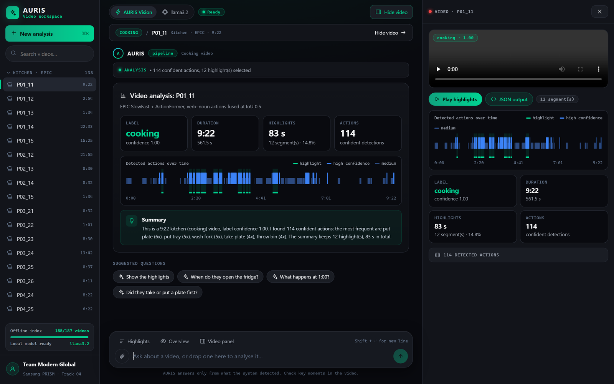
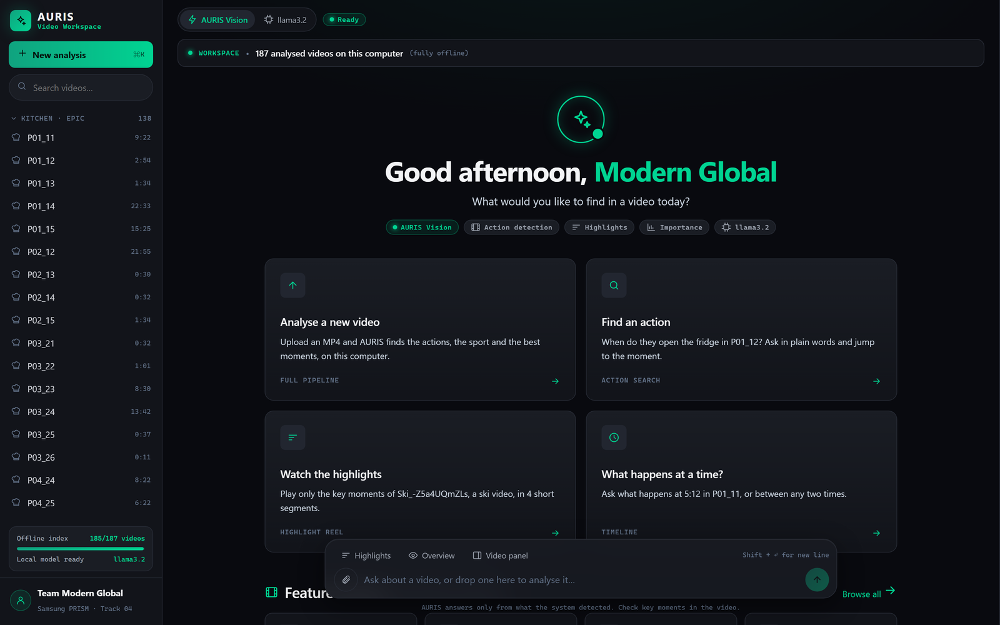
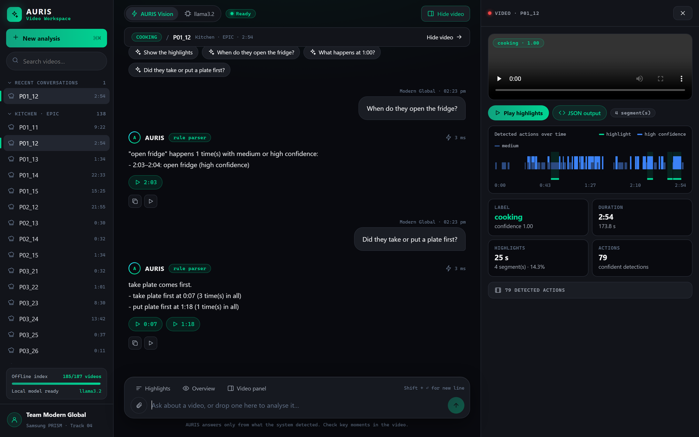
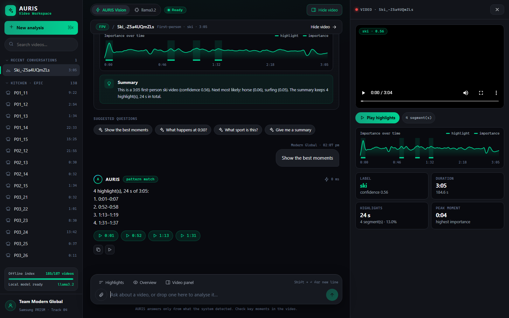

# AURIS: Action-Aware Video Summarization

**Samsung PRISM XR Hackathon 2026 · Track 04 · TEAM_MODERN GLOBAL**

Team Modern Global, SRM Institute of Science and Technology: Dhanush Poduval, Arpit Rath, Mehak Sharma,
Divya Narayanan.

AURIS turns a long first-person video into a short, explainable summary, fully offline. For every video it:

- decides whether it is a **kitchen** video or one of **14 first-person sports**;
- finds the **hand–object actions** in kitchen videos (for example "open fridge", "take plate");
- scores how **important** each moment of a sports video is;
- picks **highlights** that fit within 15% of the video;
- writes the organisers' **6-field JSON**, checked with their own validator.

On top of the pipeline, the **AURIS app** lets you upload a video, play only its highlights, read the
exact JSON output, and ask questions such as "When do they open the fridge?". Every answer comes from
what the system detected, never from a language model's guess.

---

## Submission Resources

| Resource | Link |
|---|---|
| **Presentation** (9 slides) | [`presentation/AURIS_Team_Modern_Global_Presentation.pptx`](presentation/AURIS_Team_Modern_Global_Presentation.pptx) |
| **Demo video** (2:18) | [Watch on Google Drive](https://drive.google.com/file/d/1ofBODJN_1MRF6paCYC_m3JlAzgIqGzWN/view?usp=sharing) · [`demo/AURIS_Demo_Team_Modern_Global.mp4`](demo/AURIS_Demo_Team_Modern_Global.mp4) in this repo |
| **Submission package** (`run.sh`, `code/`, `weights/`, `requirements.txt`, `outputs/`, `README.md`) | [`TEAM_MODERN GLOBAL/`](TEAM_MODERN%20GLOBAL/) |
| **187 output files** (all pass `validate.py`) | [`TEAM_MODERN GLOBAL/outputs/`](TEAM_MODERN%20GLOBAL/outputs/) |
| **Large weights** (1.8 GB, over GitHub's 100 MB file limit) | Release [`weights-v1`](https://github.com/arpit-rath/XR-Hackathon/releases/tag/weights-v1), fetched automatically by `run.sh` |
| **Package README** | [`TEAM_MODERN GLOBAL/README.md`](TEAM_MODERN%20GLOBAL/README.md) |
| **AURIS app** (brownie feature) | [`app/`](app/) · [`app/README.md`](app/README.md) · [screenshots](presentation/screenshots/) |
| **AI disclosure** | [`ai_disclosure/LangAI3.0_AI_Disclosure.docx`](ai_disclosure/LangAI3.0_AI_Disclosure.docx) |

---

## Core Features

- **Video-type router:** CLIP ViT-L/14 on the first 30 s, zero-shot against 14 sports + "cooking".
  Correct on all 185 downloadable manifest videos.
- **Kitchen action detection:** EPIC SlowFast features → ActionFormer verb and noun models → fused
  verb–noun actions. Held-out pair mAP 27.23 (tIoU 0.1–0.5).
- **Sports understanding:** CLIP features at 2 fps → category (95.7% on Samsung's 47 videos, report-only)
  and an importance score every 0.5 s.
- **Highlight selection:** greedy, non-overlapping, at least 4 s each, at most 15% of the duration.
- **Validated output:** the 6-field JSON is checked with the organisers' `validate.py`. On any failure a
  minimal valid file is still written and the exit code is 1.
- **Computed from the video alone:** no manifest look-ups, no video-ID tricks, no network at inference.
  A renamed video gives the same output.
- **Runs on a laptop:** tested on a 6 GB RTX 4050 Laptop GPU and a 48 GB RTX 6000 Ada.
- **AURIS app:** local web app with upload, timeline, highlight reel, JSON output view and a grounded chatbot.
- **Grounded chatbot:** patterns and rules answer most questions instantly; a local llama3.2 3B model
  (Ollama) is used only to resolve ambiguity, and it can only pick among actions the system detected.

---

## System Architecture

```text
                              Input video (.mp4, any name)
                                          |
                                          v
                                 ffprobe → duration
                                          |
                                          v
                       Video-type router (CLIP ViT-L/14, first 30 s)
                           zero-shot: "cooking" + 14 sports
                              /                        \
                         cooking                      sport
                            |                           |
                            v                           v
          +-----------------------------+   +-----------------------------+
          |  KITCHEN BRANCH (EPIC-100)  |   |    SPORTS BRANCH (FPVSum)   |
          |                             |   |                             |
          |  Encoder A                  |   |  CLIP ViT-L/14 @ 2 fps      |
          |  SlowFast 8x8 R50, 2304-d   |   |  frozen, 768-d              |
          |            |                |   |        |          |         |
          |            v                |   |        v          v         |
          |  ActionFormer verb (97)     |   |  Category      Importance   |
          |  ActionFormer noun (300)    |   |  probe ⊕       every 0.5 s  |
          |            |                |   |  zero-shot                  |
          |            v                |   |                             |
          |  Fusion → verb–noun actions |   |                             |
          |  IoU 0.5 · top-3 · ≤ 2000   |   |                             |
          +-------------+---------------+   +--------------+--------------+
                        |                                  |
                        +----------------+-----------------+
                                         |
                                         v
                    Highlight selector (≥ 4 s · ≤ 15% · no overlap)
                                         |
                                         v
                  JSON writer → validate.py → <video_id>.json (6 fields)
                                         |
                                         v
                AURIS app: timeline · highlight reel · JSON view · chatbot
```

The models describe the video; deterministic code decides the final output. Highlights follow fixed
rules, the JSON is always validated, and the chatbot reads its facts from that JSON.

---

## Pipeline

One video goes through [`code/run_video.py`](TEAM_MODERN%20GLOBAL/code/run_video.py):

```text
MP4 → Duration → Video type → Kitchen or Sports branch → Highlights → JSON + validate
```

### 1. Ingestion and duration

[`video_ingest.py`](video_ingest.py) (Member 1) streams frames from the MP4 at the rate each model
needs, without decoding the whole video into memory. The duration always comes from `ffprobe` on the
file, never from the manifest.

### 2. Video-type router

[`code/video_type.py`](TEAM_MODERN%20GLOBAL/code/video_type.py) takes CLIP ViT-L/14 features of the
first 30 s at 2 fps and compares them, zero-shot, against 15 prompts: the 14 FPVSum categories plus one
"cooking" prompt. The prompts were written in advance and never tuned on evaluation videos.

### 3a. Kitchen branch (EPIC-KITCHENS-100)

Member 2's action detector, in [`pipeline/`](pipeline/):

```text
Frames (30 fps, BGR, JPEG q4)
        |
        v
Encoder A: EPIC SlowFast 8x8 R50 → 2304-d feature every 16 frames
        |
        v
ActionFormer verb model (97 verbs)  +  ActionFormer noun model (300 nouns)
        |
        v
Fusion: match verb and noun segments (IoU 0.5), top 3 nouns per verb, at most 2000 actions
        |
        v
Verb–noun actions with segments and scores
```

- [`encoder_a.py`](pipeline/encoder_a.py) reproduces the released EPIC features (cosine 0.965,
  checked with [`parity_check.py`](pipeline/parity_check.py)).
- [`detect_actions.py`](pipeline/detect_actions.py) runs ActionFormer. On GPUs under 12 GB it uses
  overlapping windows, which gives the same result, only slower.
- [`training/fusion.py`](training/fusion.py) and [`training/tune_fusion.py`](training/tune_fusion.py)
  build and tune the verb–noun fusion on an internal held-out split ([`splits/holdout.txt`](splits/holdout.txt)).

### 3b. Sports branch (FPVSum)

Member 3's module, in [`fpvsum/member3_fpvsum/`](fpvsum/member3_fpvsum/):

- [`features.py`](fpvsum/member3_fpvsum/features.py): frozen CLIP ViT-L/14 features at 2 fps, 224 crop.
- [`models.py`](fpvsum/member3_fpvsum/models.py): category classifier, a linear probe blended 50/50 with
  zero-shot prompts ([`prompts.py`](fpvsum/member3_fpvsum/prompts.py)).
- [`importance.py`](fpvsum/member3_fpvsum/importance.py): training-free importance every 0.5 s,
  `0.5 × relevance + 0.25 × novelty + 0.25 × dynamics`.
- Training and data scripts are in [`fpvsum/training_code/`](fpvsum/training_code/), metrics in
  [`fpvsum/metrics/`](fpvsum/metrics/).

### 4. Highlights

Member 4's [`pipeline/highlights.py`](pipeline/highlights.py) picks the best-scoring candidates
greedily: detected actions for kitchen videos, 6 s windows around the most important moments for sports
videos. Every segment is at least 4 s long, segments never overlap, and together they stay within 15%
of the duration.

### 5. Output and validation

[`build_outputs.py`](build_outputs.py) and `run_video.py` write the JSON, then check it with the
organisers' [`validate.py`](package/validate.py). If any step fails, a minimal valid file is still
written and `run.sh` exits with code 1.

---

## Output Format

Each video produces one file with the six required fields (trimmed example from
[`P01_12.json`](TEAM_MODERN%20GLOBAL/outputs/P01_12.json)):

```json
{
  "team_id": "TEAM_MODERN GLOBAL",
  "video_id": "P01_12",
  "duration_sec": 173.82,
  "label": { "name": "cooking", "score": 0.9999 },
  "actions": [
    { "segment": [72.24, 75.81], "verb": "take", "noun": "plate", "score": 0.574717 },
    { "segment": [138.65, 143.94], "verb": "pour", "noun": "milk", "score": 0.541531 }
  ],
  "highlights": [
    { "segment": [51.24, 58.54] },
    { "segment": [138.65, 143.94] }
  ]
}
```

For sports videos, `label.name` is the sport and `actions` is `[]`, which the rules allow.

---

## Results

| Measure | Result |
|---|---|
| Output files valid (`validate.py`) | **187 / 187** |
| Videos routed correctly (cooking vs sport) | **185 / 185** downloadable manifest videos |
| Action records written | 274,994 (at most 2000 per video) |
| Verb–noun pair mAP, held-out, tIoU 0.1–0.5 | **27.23** |
| Encoder A vs released EPIC features | cosine 0.965 |
| Sports category accuracy* | **95.7%** (45 / 47) |
| Sports importance F1* | 0.226 (random 0.150) |
| Median highlight budget | 14.5% kitchen · 13.9% sports |
| Chatbot accuracy | 34/34 development questions · 17/20 held-out questions |

\* Diagnostic on Samsung's FPVSum videos, computed after the models were frozen and never used to train
or tune ([`fpvsum/metrics/diagnostic_samsung47.json`](fpvsum/metrics/diagnostic_samsung47.json)).

---

## AURIS App (brownie feature)

A local web app at `http://127.0.0.1:8000`. Nothing leaves the machine, and it doesn't change any output.



| Feature | What it does |
|---|---|
| **Browse** | All 187 results, grouped into uploads, kitchen (EPIC) and first-person sports, with search |
| **Report** | Label, duration, highlight time and action count for the selected video |
| **Timeline** | Highlights in green; actions in blue for kitchen videos; the importance curve for sports. Click to jump |
| **Play highlights** | Plays only the highlight segments, one after another |
| **JSON output** | Shows the exact output file, with Copy and Download |
| **Upload** | Button or drag-and-drop; the video is analysed with the submission's own `run.sh` (in WSL) |
| **Chat** | Questions about the selected video, with clickable timestamps |

| Start screen | Kitchen chat | Sports chat |
|---|---|---|
|  |  |  |

### How the chatbot stays fast and accurate

```text
Question
   |
   v
1. Patterns   ("what happens at 2:30", ranges, highlights, summaries)  ≈ 0 ms
   | no match
   v
2. Rules      (verb + object, phrasal verbs, "take or put … first?")   < 15 ms
   | still ambiguous
   v
3. llama3.2 3B via Ollama (picks one of the detected actions only)      ≈ 0.5 s
   |
   v
Answer built from the video's JSON (timeline.py), with timestamps
```

[`chat.py`](app/chat.py) only works out which question is being asked;
[`timeline.py`](app/timeline.py) turns the JSON into facts, so every timestamp in an answer is one the
system detected.

### App API

Served by [`app/server.py`](app/server.py) (FastAPI):

| Method | Endpoint | Purpose |
|---|---|---|
| `GET` | `/api/videos` | List all videos with their label and group |
| `GET` | `/api/video/{vid}` | Report and timeline facts for one video |
| `GET` | `/api/json/{vid}` | The raw output JSON (`?download=1` to download it) |
| `GET` | `/media/{vid}` | Stream the video file |
| `POST` | `/api/chat` | Answer a question about a video |
| `POST` | `/api/upload?name=` | Upload a new video |
| `POST` | `/api/analyze` | Start `run.sh` on an uploaded video |
| `GET` | `/api/analyze/{job}` | Progress of an analysis job |
| `GET` | `/api/status` | Server and Ollama status |

Deep links open a view directly, for example `#v=P01_12&q=When do they open the fridge?&json=1&t=120`.

---

## Project Structure

```text
XR-Hackathon/
│
├── TEAM_MODERN GLOBAL/            # the submission package
│   ├── run.sh                     # ./run.sh <video.mp4> <out.json>
│   ├── fetch_weights.sh           # downloads the 4 large weights (SHA-256 checked)
│   ├── build_package.sh           # rebuilds code/ and small weights from the repo sources
│   ├── requirements.txt
│   ├── WEIGHTS_SHA256SUMS.txt
│   ├── code/
│   │   ├── run_video.py           # the whole system for one video
│   │   ├── run_folder.py          # batch run, models loaded once
│   │   ├── video_type.py          # cooking-or-sport router
│   │   ├── video_ingest.py
│   │   ├── encoder_a.py
│   │   ├── detect_actions.py
│   │   ├── fusion.py
│   │   ├── highlights.py
│   │   ├── member3_fpvsum/
│   │   ├── third_party/           # ActionFormer, epic-kitchens-slowfast (inference parts)
│   │   ├── validate.py
│   │   └── supported_classes.json
│   ├── weights/                   # small weights in git; large ones from the release
│   └── outputs/                   # 187 <video_id>.json files
│
├── video_ingest.py                # Member 1: MP4 ingestion and streaming decoder
├── milestone1_load.py
│
├── pipeline/                      # Member 2: EPIC action detection + integration
│   ├── run_video.py
│   ├── run_folder.py
│   ├── run_manifest.py
│   ├── video_type.py
│   ├── encoder_a.py
│   ├── detect_actions.py
│   ├── parity_check.py
│   └── highlights.py              # Member 4: highlight selection
│
├── training/                      # action-detector training, fusion tuning, held-out evaluation
│   ├── configs/
│   ├── fusion.py
│   ├── tune_fusion.py
│   ├── eval_holdout.py
│   └── ...
├── splits/holdout.txt
│
├── fpvsum/                        # Member 3: FPVSum importance + category
│   ├── member3_fpvsum/
│   ├── training_code/
│   ├── weights/
│   ├── metrics/
│   ├── reports/
│   └── logs/
│
├── build_outputs.py               # Member 4: output assembly
│
├── app/                           # AURIS demo app and chatbot
│   ├── server.py
│   ├── chat.py
│   ├── timeline.py
│   ├── static/index.html
│   ├── test_chat.py
│   ├── test_chat_holdout.py
│   └── start_app.bat
│
├── package/                       # organisers' student package (manifest, classes, validator)
├── presentation/                  # the 9-slide deck and app screenshots
├── demo/                          # the demo video
├── ai_disclosure/                 # the AI disclosure form
├── requirements.txt
└── README.md
```

### Team Responsibilities

| Member | Name | Work | Main files |
|---|---|---|---|
| Member 1 | Dhanush Poduval | MP4 ingestion and streaming decoder | [`video_ingest.py`](video_ingest.py) |
| Member 2 | Arpit Rath | EPIC action detection, integration, AURIS app | [`pipeline/`](pipeline/), [`training/`](training/), [`app/`](app/) |
| Member 3 | Mehak Sharma | FPVSum importance and category | [`fpvsum/`](fpvsum/) |
| Member 4 | Divya Narayanan | Highlights and submission outputs | [`pipeline/highlights.py`](pipeline/highlights.py), [`build_outputs.py`](build_outputs.py) |

---

## Getting Started

### Prerequisites

- Linux or WSL2 Ubuntu 22.04
- Python 3.10
- An NVIDIA GPU with CUDA 12.8 drivers (6 GB is enough)
- ffmpeg, build-essential, curl
- Git

### 1. Clone the repository

```bash
git clone https://github.com/arpit-rath/XR-Hackathon.git
cd "XR-Hackathon/TEAM_MODERN GLOBAL"
```

### 2. Install system packages

```bash
sudo apt install -y ffmpeg build-essential python3.10-venv curl
```

### 3. Create the environment

```bash
python3.10 -m venv venv
. venv/bin/activate
pip install -r requirements.txt
```

### 4. Fetch the large weights

```bash
./fetch_weights.sh
```

This downloads 1.8 GB from the [`weights-v1`](https://github.com/arpit-rath/XR-Hackathon/releases/tag/weights-v1)
release and checks each file against `WEIGHTS_SHA256SUMS.txt`. `run.sh` does this itself if the
weights are missing.

### 5. Run one video

```bash
./run.sh sample.mp4 out/sample.json
```

The first run also builds ActionFormer's small C++ NMS extension.

### 6. Validate the output

```bash
python code/validate.py --dir out
```

### Speed (6 GB RTX 4050 Laptop GPU)

| Video | Time |
|---|---|
| 3-minute EPIC kitchen video | about 2 min |
| 30-minute EPIC kitchen video | about 10 min |
| 3-minute FPVSum sports video | about 30 s |

---

## Running the AURIS App (Windows)

1. Install [Ollama](https://ollama.com) and pull the model:

   ```bash
   ollama pull llama3.2
   ```

2. Start the app by double-clicking [`app/start_app.bat`](app/start_app.bat), or:

   ```bat
   cd app
   py -3.12 -m venv .venv
   .venv\Scripts\python.exe -m pip install -r requirements.txt
   .venv\Scripts\python.exe server.py
   ```

3. Open `http://127.0.0.1:8000`.

Without Ollama the chatbot still works in pattern-and-rule mode. Uploads are analysed with the package's
`run.sh` inside WSL. Paths can be changed with the `APP_OUTPUTS`, `APP_VIDEOS`, `APP_UPLOADS`,
`APP_PACKAGE`, `APP_WSL_PY` and `APP_PORT` environment variables. More detail is in
[`app/README.md`](app/README.md).

---

## Testing and Evaluation

| What | How |
|---|---|
| All outputs valid | `python code/validate.py --dir outputs` |
| Encoder matches released EPIC features | [`pipeline/parity_check.py`](pipeline/parity_check.py) |
| Held-out action mAP | [`training/eval_holdout.py`](training/eval_holdout.py) on [`splits/holdout.txt`](splits/holdout.txt) |
| FPVSum category and importance | [`fpvsum/metrics/`](fpvsum/metrics/), [`fpvsum/training_code/diagnostic_samsung47.py`](fpvsum/training_code/diagnostic_samsung47.py) |
| Chatbot, development questions | `python app/test_chat.py` |
| Chatbot, held-out questions | `python app/test_chat_holdout.py` |

---

## Models and Data

- **Action detector:** the released ActionFormer EPIC-KITCHENS-100 verb and noun checkpoints, on
  features from the EPIC SlowFast checkpoint, both trained on EPIC-KITCHENS-100 *train*. The manifest's
  EPIC videos are the *validation* split, so nothing was trained on them.
- **Sports module:** frozen OpenAI CLIP ViT-L/14. The category head was trained on 37 FPVSum videos that
  are not in the manifest. The importance scorer is training-free.
- **Chat model:** llama3.2 3B, run locally through Ollama.
- Samsung's evaluation videos were never used for training or tuning.

---

## Notes for the Organisers

- Two FPVSum manifest videos can no longer be downloaded (`Scuba_KD74Ywuy9ng` is private,
  `Scuba_Um4kqB8bQBg` was removed). Their output files are valid placeholders.
- `code/third_party/epic-kitchens-slowfast` is licensed CC BY-NC-SA 4.0 (non-commercial);
  ActionFormer is MIT.

---

## References

- EPIC-KITCHENS-100: [epic-kitchens.github.io](https://epic-kitchens.github.io/)
- ActionFormer: [happyharrycn/actionformer_release](https://github.com/happyharrycn/actionformer_release)
- EPIC SlowFast: [epic-kitchens/epic-kitchens-slowfast](https://github.com/epic-kitchens/epic-kitchens-slowfast)
- CLIP: [openai/CLIP](https://github.com/openai/CLIP) · [mlfoundations/open_clip](https://github.com/mlfoundations/open_clip)
- Ollama and llama3.2: [ollama.com/library/llama3.2](https://ollama.com/library/llama3.2)
- FastAPI: [fastapi.tiangolo.com](https://fastapi.tiangolo.com/)
